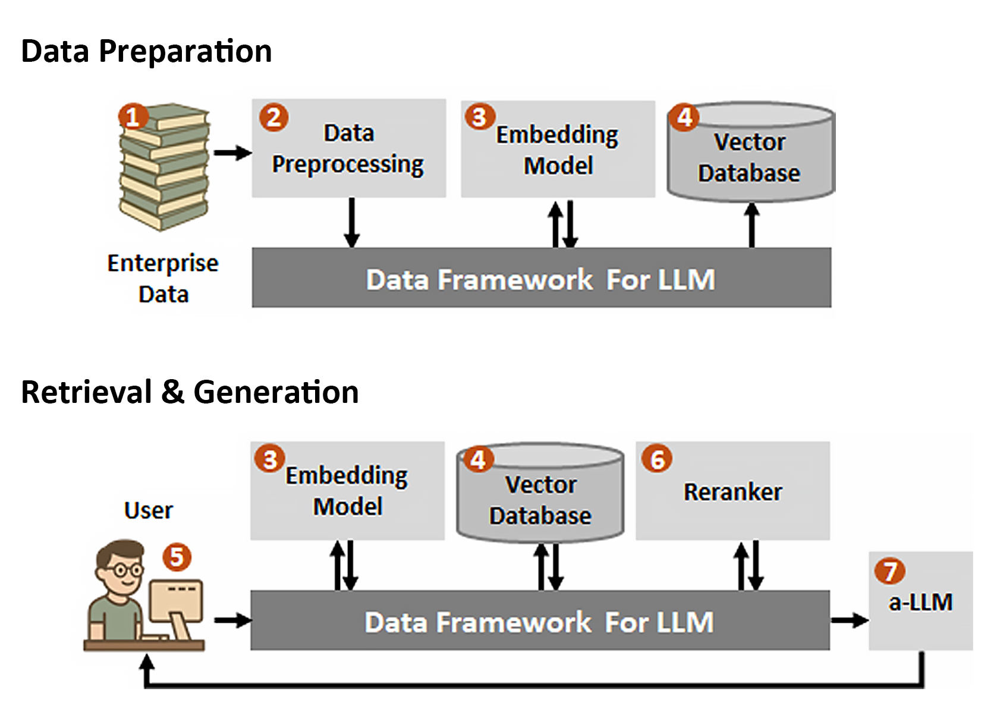
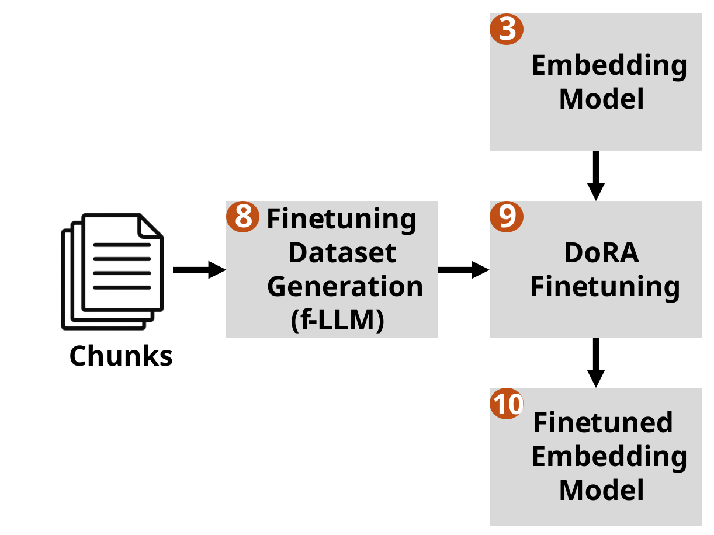

# DoRAG

This repository contains the implementation and experimental pipeline for a retrieval-augmented generation (RAG) based research project. The project includes data preprocessing, fine-tuning dataset generation, RAG inference, DoRA-based model adaptation, and performance evaluation.

## Presentation Video

The oral presentation video for this project is included in this repository.

<video src="./Oral%20Presentation_Shu-Chi%20Huang.mp4" controls width="800">
  Your browser does not support the video tag.
</video>

## Repository Structure

```text
DoRAG/
├── 1_Enterprise_Data/              # Original enterprise documents or source data
├── 2_Data_Preprocessing/           # Scripts for document parsing and preprocessing
├── 8_FT_Dataset_Generation/        # Fine-tuning dataset generation scripts
├── 9_DoRA/                         # DoRA fine-tuning related implementation
├── Performance_Evaluation/         # Evaluation scripts and experimental results
├── RAG_Inference/                  # RAG-based inference scripts
├── .gitignore
├── data_preprocessing.bat          # Batch script for running preprocessing
└── Oral Presentation_Shu-Chi Huang.mp4
```

## Project Overview

This project implements a domain-specific Retrieval-Augmented Generation (RAG) framework for enterprise documents. The overall system is divided into three main stages: data preparation, retrieval and generation, and model fine-tuning.

### Data Preparation

The first stage focuses on preparing enterprise documents for downstream LLM applications. Raw enterprise data are processed through a data preprocessing pipeline, where documents are cleaned, segmented, and transformed into structured chunks. These chunks are then encoded by an embedding model and stored in a vector database.

This stage provides the knowledge foundation for the RAG system by converting unstructured enterprise documents into retrievable vector representations.

<p align="center">
  
</p>

### Retrieval and Generation

During inference, the user query is first encoded using the same embedding model. The system retrieves relevant document chunks from the vector database and further refines the retrieved candidates using a reranker. The selected context is then provided to the adapted language model for answer generation.

This retrieval-and-generation process enables the model to generate responses based on external enterprise knowledge instead of relying only on the model's internal parameters.

### Fine-tuning

In addition to retrieval-based generation, this project also includes a fine-tuning stage. The fine-tuning dataset is generated from the prepared enterprise data and used to adapt the language model to the target domain. The adapted LLM is then integrated into the RAG pipeline to improve domain-specific response quality.

<p align="center">
  
</p>

## Requirements

This project was developed using Python. It is recommended to create a dedicated Conda environment before running the scripts.

```bash
conda create -n dorag python=3.12
conda activate dorag
```

Install the required packages according to the scripts used in each module.

## Usage

### 1. Data Preprocessing

This stage converts the original enterprise PDF documents into cleaned and structured text chunks for downstream RAG processing.

#### 1.1 PDF Text Extraction

Put the input PDF files (`.pdf`) in `1_Enterprise_Data/`, then extract the text content from each PDF file and save the output as text files (`.txt`) in `extracted_text/`.

```bash
python 2_Data_Preprocessing/pdf_extraction.py --pdf_dir 1_Enterprise_Data --output_dir extracted_text
```

#### 1.2 Text Flattening

Use the extracted text files (`.txt`) from `extracted_text/` as input, remove excessive whitespace and line breaks, and save the flattened text files (`.txt`) in `flattened_text/`.

```bash
python 2_Data_Preprocessing/text_flattener.py --input_dir extracted_text --output_dir flattened_text
```

#### 1.3 Identifier Generation

Use the flattened text files (`.txt`) from `flattened_text/` as input, generate section identifier files containing the paper title, section titles, and sentence-initial fragments, and save the output as JSON files (`.json`) in `identifiers/`.

```bash
python 2_Data_Preprocessing/identifier_generation.py --input_dir flattened_text --output_dir identifiers
```

#### 1.4 Chunk Extraction

Use the flattened text files (`.txt`) from `flattened_text/` and the identifier files (`.json`) from `identifiers/` as input, split each document into section-level chunks, and save the output as chunk JSON files (`.json`) in `chunks/`.

```bash
python 2_Data_Preprocessing/chunk_extraction.py --identifier-dir identifiers --text-dir flattened_text --output-dir chunks
```

#### 1.5 Chunk Refinement

Use the section-level chunk files (`.json`) from `chunks/` as input, clean and refine the text content, and save the refined chunk files (`.json`) in `refined_chunks/`.

```bash
python 2_Data_Preprocessing/chunk_refinement.py --chunk-dir chunks --output-dir refined_chunks
```

#### 1.6 Re-chunking

Use the refined chunk files (`.json`) from `refined_chunks/` as input, further split them into smaller topic-based chunks, and save the final output as a single JSON file (`chunks.json`).

```bash
python 2_Data_Preprocessing/re-chunking.py --input_dir refined_chunks --output_file chunks.json
```

Alternatively, the whole preprocessing pipeline can be executed using the batch file:

```bash
data_preprocessing.bat
```


### 2. Fine-tuning Dataset Generation

This stage generates fine-tuning data from the preprocessed chunk file. Each chunk is used as a positive document, and the script generates corresponding queries and hard negative documents for training data construction.

#### 2.1 Query and Hard Negative Document Generation

Use the preprocessed chunk file (`.json`) as input, generate queries and hard negative documents based on each chunk, and save the output as a fine-tuning dataset file (`.json`).

```bash
python 8_FT_Dataset_Generation/Generate_query_deepseek.py --input chunks.json --output finetuning_dataset.json
```

The generated dataset contains the query, chunk ID, positive document, and hard negative document for each training sample.

#### 2.2 Fine-tuning Dataset Verification

Use the generated fine-tuning dataset file (`.json`) as input, verify whether the positive document is relevant to the query and whether the hard negative document is topically related but not directly useful for answering the query, and save the checked output as a JSON file (`.json`).

```bash
python 8_FT_Dataset_Generation/FTdataset_check_llama33.py --input_file finetuning_dataset.json --output_file checked_finetuning_dataset.json
```

The checked dataset adds verification results for the positive document, hard negative document, and explanation generated by the evaluator model.

### 3. DoRA Fine-tuning

This stage adapts the embedding model using DoRA-based parameter-efficient fine-tuning. The training script reads the fine-tuning dataset, replaces selected linear projection layers with DoRA/LoRA modules, trains the model with positive and hard negative documents, and saves checkpoints, merged models, logs, and evaluation results.

#### 3.1 Configuration

Before running fine-tuning, edit the configuration file:

```text
9_DoRA/config.txt
```

The configuration file defines the base model path, output directory, fine-tuning dataset path, DoRA/LoRA settings, training hyperparameters, and loss settings.

Example configuration fields include:

```text
local_dir: ./models/gte-Qwen2-1.5B-instruct
out_dir: ./models/gte-Qwen2-1.5B-instruct-dora
data_path: finetuning_dataset.json
rank: 32
alpha: 64
batch_size: 16
grad_accum: 32
epochs: 10
```

#### 3.2 Run DoRA Fine-tuning

Use the fine-tuning dataset file (`.json`) as input, train the embedding model with DoRA/LoRA adaptation, and save the trained model outputs to the configured output directory.

```bash
python 9_DoRA/DoRA_FT.py
```

#### 3.3 Output Files

The fine-tuning process saves the following outputs in the configured output directory:

```text
<out_dir>/
├── config.txt
├── best/
├── epoch_XX/
├── epoch_XX_merged/
├── logs/
│   ├── train_log.csv
│   ├── training_curves_per_micro.png
│   └── training_curves_per_step.png
└── test_metrics.txt
```

The `best/` directory stores the best checkpoint selected by validation loss. The `epoch_XX/` directories store epoch checkpoints, while the `epoch_XX_merged/` directories store merged HuggingFace-compatible model weights. The `logs/` directory contains training metrics and curve figures, and `test_metrics.txt` records test-set evaluation results.


### 4. RAG Inference

This stage performs retrieval-based answer generation using the constructed chunk file, embedding model, vector database, reranker, and selected language model. The inference script first builds or loads a Chroma vector database, retrieves relevant chunks for each query, optionally applies reranking, and then generates answers based on the retrieved context.

#### 4.1 Configuration

Before running inference, edit the configuration section in:

```text
RAG_Inference/implement_k_LTP.py
```

The configuration defines the input chunk file, embedding model path, vector database path, query file, reranker model, retrieval settings, result directory, and output file.

Example configuration fields include:

```python
config = {
    "input_text_dir": "chunks.json",
    "embedding_model_path": "Alibaba-NLP/gte-Qwen2-1.5B-instruct",
    "database_path": "vectorDB_gte2_test",
    "query_file": "Queries.txt",
    "tart_model": "facebook/tart-full-flan-t5-xl",
    "num_results": 50,
    "result_dir": "results",
    "result_file": "rag_results.json",
    "retrieval_method": "retrieve_with_re_ranker",
    "set_up_database": True,
    "k": [20]
}
```

#### 4.2 Input Files

Prepare the following input files before running RAG inference:

```text
chunks.json     # Preprocessed chunk file generated by the data preprocessing pipeline
Qs.txt          # Query file, with one query per line
```

The chunk file (`.json`) is used to construct the vector database. The query file (`.txt`) contains the questions to be answered by the RAG pipeline.

#### 4.3 Run RAG Inference

Run the inference script:

```bash
python RAG_Inference/implement_k_LTP.py
```

If `set_up_database` is set to `True`, the script will construct a new vector database from `chunks.json`. If it is set to `False`, the script will reuse the existing vector database specified by `database_path`.

#### 4.4 Output Files

The inference results are saved to the configured result directory.

```text
<result_dir>/
└── rag_results.json
```

The output JSON file contains the query ID, original query, retrieved context, retrieval time, generated answer, and generation time.

Example output fields include:

```json
{
  "qid": 0,
  "query": "...",
  "retrieved_context": ["..."],
  "retrieved_time": 0.0,
  "answer_1": "...",
  "generation_time_1": 0.0
}
```


### 5. Performance Evaluation

This stage evaluates and compares the generated answers from different RAG settings. The evaluation workflow first compares two sets of generated answers using GPT-based scoring, then analyzes the score statistics, win/loss/draw results, and confidence intervals.

#### 5.1 Answer Comparison

Before running the comparison script, edit the file paths and answer fields in:

```text
Performance_Evaluation/comparison_k_mul.py
```

The script compares two RAG result files (`.json`) and evaluates the selected answer fields for each query.

Example configuration fields include:

```python
file1 = "result1.json"
file2 = "result2.json"
header1 = "answer_20"
header2 = "answer_10"
output_dir = "comparison_result"
output_file = "comparison_result.json"
question_file = "Queries.txt"
```

Run the comparison script:

```bash
python Performance_Evaluation/comparison_k_mul.py
```

The output file (`.json`) contains the query ID, query, scores for both answers, feedback, and the compared answers.

#### 5.2 Evaluation Result Analysis

Before running the analysis script, edit the evaluated comparison result path in:

```text
Performance_Evaluation/data_analyze.py
```

Example configuration field:

```python
file_path = "comparison_result/comparison_result.json"
```

Run the analysis script:

```bash
python Performance_Evaluation/data_analyze.py
```

The analysis script calculates the mean score, standard deviation, win/loss/draw counts, win rates, and 95% confidence intervals for the compared answers.

#### 5.3 Output Files

The performance evaluation stage produces the following output files:

```text
comparison_result/
├── comparison_result.json
└── comparison_result.analyze_result_<sample_size>.txt
```

The comparison result file (`.json`) stores the detailed answer-level evaluation results. The analysis result file (`.txt`) stores the summarized statistics and confidence intervals.
